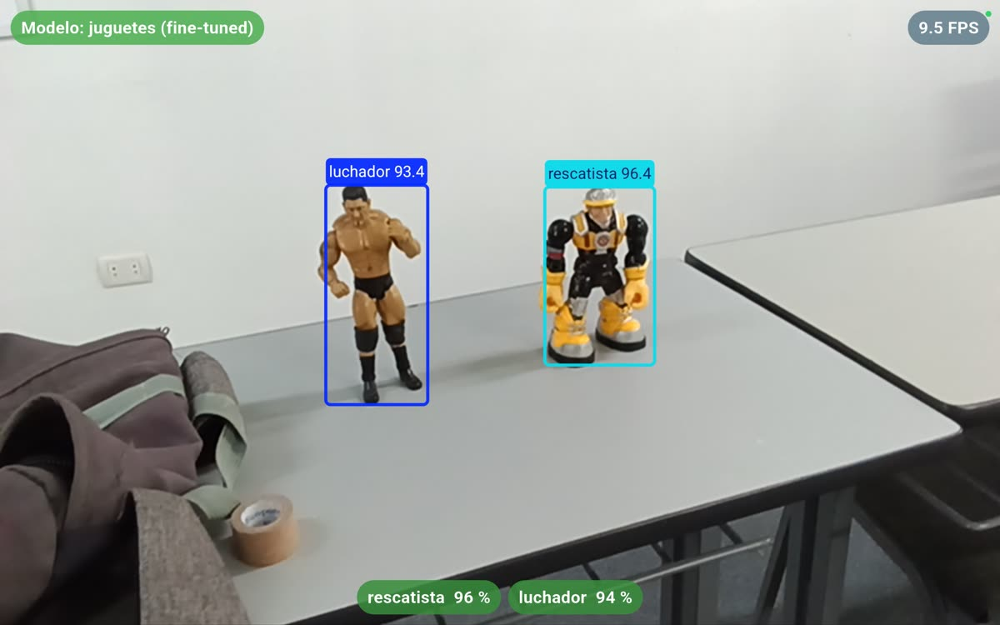
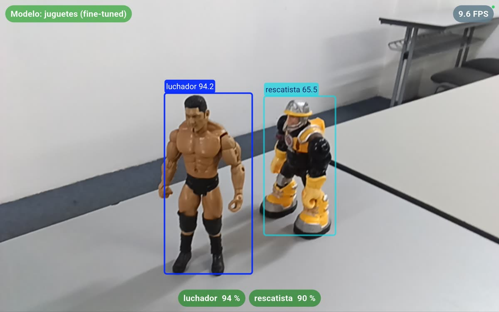
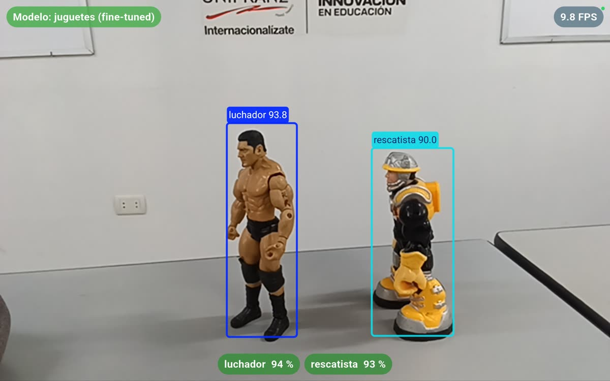
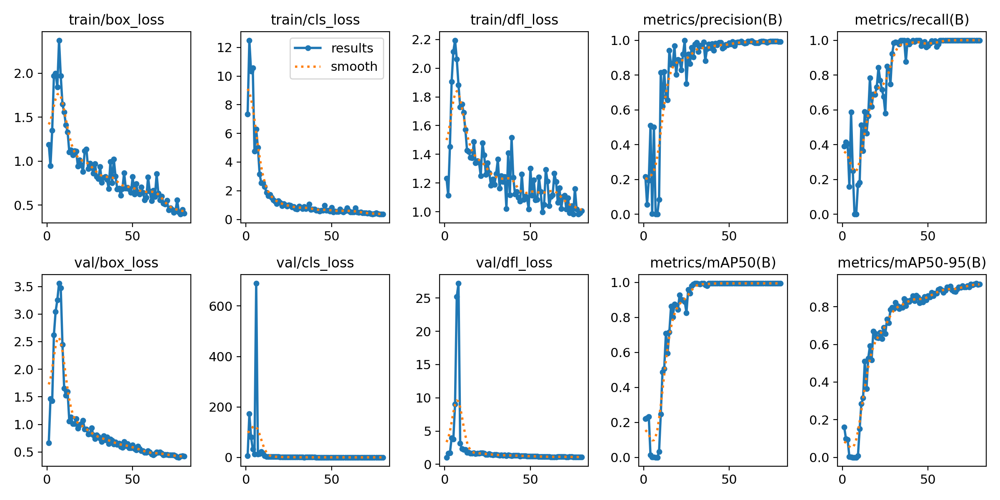

# Toy Detector · Detector de juguetes con YOLO

App Android que reconoce **dos juguetes en tiempo real** con la cámara: un luchador y un rescatista.
Entrené el modelo yo mismo con **transfer learning**: partí de YOLOv8 preentrenado y lo ajusté con mis propias fotos.
La detección corre **en el dispositivo**, sin internet, a unos 10 FPS en una tablet de gama media.

<p align="center">
  
</p>

## En acción

| Sobre la mesa | De cerca | En el aula |
|---|---|---|
|  |  |  |
| Los dos juguetes reconocidos con 96 % y 94 % de confianza, aunque hay otros objetos en la escena. | Más cerca y en ángulo, cada uno con su caja y su porcentaje. | De perfil, otro ángulo que el modelo también aprendió. |

## Cómo lo hice

**1. Dataset propio.** Grabé los juguetes con la tablet y con un iPhone, saqué los cuadros de los videos y
los etiqueté en [Roboflow](https://roboflow.com) (una caja por juguete, con su clase).
Resultado: **162 imágenes** a 640 px, divididas en entrenamiento (113), validación (32) y prueba (17).

**2. Transfer learning + fine-tuning** ([`entrenamiento_colab.ipynb`](entrenamiento_colab.ipynb)).
En Google Colab, con una GPU T4, partí de `yolov8n.pt`, un modelo que ya sabe ver formas y bordes porque fue entrenado con las 80 clases de COCO.
Lo ajusté durante 80 épocas con mis imágenes. YOLO añade variaciones automáticas (mosaicos, giros, brillo y color, escala)
para que el modelo no se aprenda las fotos de memoria.

| Métrica (validación) | Valor |
|---|---|
| mAP50 | 0.995 |
| mAP50-95 | 0.919 |
| Precisión | 0.993 |
| Recall | 1.000 |



> **Ojo con estas cifras:** las imágenes de entrenamiento y validación salen de los mismos videos, así que se parecen mucho
> y la métrica sale más alta de lo que sería con fotos totalmente nuevas. Lo comprobé en la práctica: con confianza baja,
> la v1 confundía autos amarillos con el rescatista (61-70 %), así que la app usa **75 % de confianza mínima** por defecto.
> Para una v2: más fondos distintos, fotos de días diferentes y separar los videos entre entrenamiento y validación.

**3. Exportar para el celular.** Exporté el modelo a **LiteRT (TensorFlow Lite)** con `nms=None`: el filtro que elimina cajas
duplicadas (*Non-Maximum Suppression*) lo hace la app, como pide el plugin `ultralytics_yolo`.

**4. La app** ([`lib/main.dart`](lib/main.dart)). Flutter con el plugin `ultralytics_yolo`, que dibuja las cajas sobre la cámara en vivo.
Tiene:
- Un contador de cada juguete y su confianza en tiempo real, además de los FPS.
- Un control deslizante para la confianza mínima (25-95 %), linterna y cambio de cámara.
- **Cargar otro modelo `.tflite` desde el teléfono** sin compilar la app de nuevo, útil para probar una v2 recién entrenada.
- Si falta el modelo propio, usa el modelo oficial de COCO para que la app siga funcionando.

## Pruébalo

- **Instalar:** descarga el APK desde [Releases](../../releases) y ábrelo en un Android 7.0 o superior (hay que permitir instalar apps de origen desconocido).
- **Compilar:** con Flutter 3.41:
  ```bash
  flutter pub get
  flutter run
  ```

Sin los dos juguetes, puedes apuntar la cámara a las fotos de [`docs/`](docs/) en otra pantalla.

## Estructura

```
lib/main.dart                 la app (cámara, cajas, controles)
assets/models/juguetes.tflite modelo fine-tuneado que va dentro de la app
modelo_v1/                    best.pt (PyTorch), métricas y gráficas del entrenamiento
entrenamiento_colab.ipynb     notebook de Colab: dataset → entrenamiento → evaluación → exportación
docs/                         capturas para este README
```

## Licencia

[AGPL-3.0](LICENSE). Uso YOLOv8 y el plugin `ultralytics_yolo` de [Ultralytics](https://ultralytics.com), que tienen esa licencia,
y un modelo ajustado a partir de ellos también la hereda.
